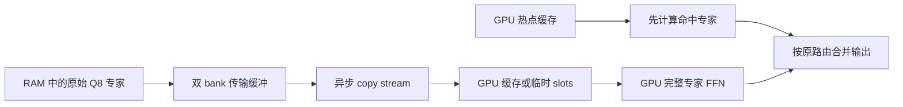

# Qwen3.6-35B-A3B Q8：RAM 专家存储与 GPU 0

当前本机 `strata-a3b-q8.json` 使用原 Strata 风格的 CPU/GPU 协作：GPU 计算主干和热点专家，持久 CPU 专家池并行计算冷专家；启用整窗门铃、MTP K2、短提示 CPU 分担和注意力 mask 复用，context 262144、batch 2048、只用 GPU 0、idle unload 为 0。当前冻结二进制为 `build-a3b-q8-tuned/bin/strata-moe.exe`。短输入实测见 [完整 API 结果](../bench/results/2026-10-15-a3b-q8-tuned-api/README.md)，实际 50000 token 输入及长上下文限制见 [256K/50K 实测](../bench/results/2026-10-15-a3b-q8-256k-50k/README.md)。100 token/s 尚未达到。

先前完整 GPU 专家计算方案保留在 `strata-a3b-q8-gpu-compatible.json` 和 `build-a3b-q8-compatible/`，均逐字节保留。下文的 GPU-only 调度说明及旧测试记录对应这条兼容路径；官方 Q8 模型与 MTP 权重共用。

这个独立路径使用 **ggml-org 发布的完整标准 Q8_0 GGUF**，没有由本项目重新量化、剪枝或替换模型权重。120 个 routed expert 张量全部 Q8_0，norm、bias 等小型张量保留 F32；模型及 MTP 的原始来源、固定 revision、类型和共享表 payload 已核验。

Q8 文件为 34.37 GiB，仅 routed 专家就有 31.875 GiB。本机 GPU 0 是驱动报告 22,528 MiB 的 RTX 2080 Ti，链路 PCIe 3.0 ×16，所以 **Q8 不能完整常驻这张卡的显存**。它采用 RAM 专家存储、GPU 热点缓存和有界临时 GPU slots。`--gpu-only-experts` 禁止 CPU 专家矩阵计算；CPU 负责 HTTP、分词、根据 GPU 路由结果调度，以及把原始权重字节打包到传输缓冲。

本页记录已核验的模型事实与已实现的路径。[Q8 API 记录](../bench/results/2026-10-14-a3b-q8-global-api/README.md)已完成 30 个请求，分别报告 TTFB、首输出 token 等待、decode、prefill 与资源占用：六组 greedy 的 decode 中位数为 27.0–38.0 token/s。自然代码/中文题为 34.6/35.0 token/s，首输出等待 1.245/0.803 秒；这两题与 profile 训练 prompt 重合。[独立进程的新题六请求](../bench/results/2026-10-14-a3b-q8-global-api/heldout/README.md)另测 BFS/事务隔离，分别为 34.7/36.9 token/s、TTFT 1.374/0.922 秒，没有与前 30 请求池化。现有 Q4 的 102.7 token/s 代码题结果不作为 Q8 速度，当前 Q8 没有达到 100 token/s。

## 权重来源与完整 8-bit

| 项目 | 固定值 |
| --- | --- |
| Repo | `ggml-org/Qwen3.6-35B-A3B-GGUF` |
| Revision | `baec3ebee244827cda0f4557eafa8b28f7545fa6` |
| 目标文件 | `Qwen3.6-35B-A3B-Q8_0.gguf` |
| 文件字节数 | 36,903,139,328 |
| 发布 SHA-256 | `d8d7842cc657d720f39546878e431937c84473aa130c36371669ac17c80c7361` |
| 实际 tensor 类型 | 432 × Q8_0，301 × F32；其中 routed 专家 120/120 × Q8_0 |
| Routed 专家字节数 | 34,225,520,640，即 31.875 GiB |
| 架构 | `qwen35moe`，40 层，hidden=2048，256 专家 / 每 token 选 8 个 |

标准 Q8_0 每 32 个权重使用 34 字节，包含 FP16 scale；这里没有混用 Q4/Q5/Q6 或 IQ3 专家。CPU 打包和 GPU 上传保留 GGUF 权重字节，不会在传输时再降位。Q8_0 本身仍是量化，不等同于 BF16 无损；是否满足具体任务的质量要求需要任务评测，不能从位数或正常输出推断。

[固定 revision 下载](https://huggingface.co/ggml-org/Qwen3.6-35B-A3B-GGUF/resolve/baec3ebee244827cda0f4557eafa8b28f7545fa6/Qwen3.6-35B-A3B-Q8_0.gguf?download=true)。Header、三张完整共享表的远程 Range 核验及复现脚本见 [量化与来源研究](../bench/results/2026-10-14-a3b-q8-research/README.md)。研究阶段的整文件 SHA 来自 HF 发布值；下载完成后已计算本地完整文件 SHA 并匹配。profile 生成器的独立完整文件校验也匹配，记录耗时 28.490 秒。

下载器保持 TLS 证书与 hostname 校验。断点状态记录模型身份和已完成的具体块；丢失状态时不信任预分配文件的长度。完整 SHA 失败不会发布文件，坏 partial 保留但完成块状态清空，下次重写；已有错误 target 保留并拒绝使用。[离线下载器回归](../tools/test_a3b_download.py)用真实临时文件和 SHA、mock HTTP Range 验证了九个成功/失败/恢复场景，不访问外网或 GPU。

## MTP 保留与严格共享

MTP 使用同 repo/revision 的 `mtp-Qwen3.6-35B-A3B-Q8_0.gguf`，1,990,649,632 字节，文件 SHA-256 为 `f6cb995fab78e7284097b2e13508e8daad4ffc6a747b433aef399f4e48524b5a`。

目标模型的 `token_embd.weight`、`output.weight` 和 `output_norm.weight` 已分别读取完整 payload，并与现有 MTP 逐表 SHA-256、类型、shape 比较，全部严格相同。因此 `--share-mtp-weights` 可以借用目标 GPU 指针，复用约 1,030.6 MiB 的输入/输出表；独立加载的 MTP 原 CPU 副本仍保留，不参与矩阵计算。它不是通过修改 Q8 头来实现共享。

MTP 草稿必须由目标模型实际验证，只有目标接受的 token 才构成输出。拒绝后同时修剪 KV、Gated DeltaNet 状态和草稿状态。短验证窗口使用已实现的专家单列算术及 `--native-attention-exact`；是否通过 Q8 的独立顺序参考、accepted-prefix、状态快照及真实 MTP 边界测试，以本轮验证记录为准，不用输出看起来正常代替数值验证。

贪心选择可使用 GPU sampler，只传回 token 和有限性 guard；非零 temperature 或 penalty 的目标取样器仍由 CPU 选择 token。这不把专家矩阵移到 CPU，但会影响吞吐，应在不同采样设置下分别测量。

## GPU-only 专家调度

`--gpu-only-experts` 自动启用完整 routed FFN 和 GPU embedding。每层将 gate/up/SwiGLU/down 作为完整专家调度：

1. 路由命中的常驻 GPU 专家先提交计算。
2. 未命中专家从 RAM 按原量化字节打包到双 bank 传输缓冲；`--expert-staging-slots` 控制每 bank 的容量，默认 8，范围 1–64。
3. 独立 copy stream 异步上传。GPU events 管理 copied/consumed 状态，避免覆盖仍在使用的 bank；下一 bank 的复制可以与已提交的 GPU 命中或上一 bank 的计算重叠。
4. 满足缓存策略的专家进入 persistent cache，其余在临时 GPU slots 完成完整 FFN。RAM 未命中分支没有 CPU 专家计算回退。



双 bank 的重叠是执行顺序与事件设计，不预设已隐藏多少 PCIe 时间。PCIe 3.0 ×16 上的真实传输量、缓存命中与输出速度需要一起测量。测试冻结 cache admission 时只固定 persistent placement，未命中专家仍必须通过 staging 在 GPU 计算；不能用冻结缓存阻止真实 miss 工作。

`--pageable-experts` 可让整个专家存储使用普通 RAM，而仅保留有界 pinned 传输缓冲。没有这个开关时沿用既有 host buffer 策略。它改变存储和传输方式，不启用 CPU 专家运算。

## Dense Q8 权重复用：显式开关

本轮的 `STRATA_A3B_DENSE_Q8_REUSE=1` 是 opt-in，默认关闭。它针对 SM75、Q8_0 dense projection 的短验证窗口，在一个 CTA 内复用读入的量化权重，对多个输入分别累加，保留 singleton MMVQ 的 K 分区和归约顺序。它不改模型权重、量化格式或专家路由。

该 dispatch 需要 `--native-dense-exact` 产生的 `[K,1,T]` 布局；仅设置环境变量而没有该布局不会选择此 kernel。范围为 2–8 个 token，非 SM75、普通 prefill、routed-ID 和 fused projections 仍走原分支。环境变量在首次调用时读取，改变它需要新进程。启用前后的 parity 和本机速度都应分别记录，不能仅因开关存在就宣称加速。

## 全局热专家 profile：按真实预算分配

`tools/a3b_cache_profile.py` 根据真实模型的 routing TSV 生成 `STRATA_A3B_EXPERT_PROFILE_V1`。它先核验当前 A3B 的 120 个 routed tensor 都是标准 Q8_0，逐个 gate/up/down 专家 bundle 为 3,342,336 bytes；再对整个 GGUF 做 SHA-256，将模型身份、geometry、训练 trace 和 benchmark JSON 指纹写入 profile 与 provenance。运行时 C++ loader 再核验完整文件 SHA 一次，并在日志记录耗时；不能用路径或文件名替代模型身份。

Fused FFN 只记 gate routes；非 fused 的三个 projection 对同一 layer/expert 取最大值，不能把一次路由乘三。多个独立执行 trace 的计数再相加。分配器按运行时真实 cache budget 选全局正分 top N，返回每层具体 expert ID 与真实 bytes；它允许早期层多分专家，零分专家不占 cache。它不改变模型权重、路由选择或未命中专家必须在 GPU 完成计算的要求。

[首个有效 profile 的记录](../bench/results/2026-10-14-a3b-q8-profile/README.md)只包含同一真实 prompt 的两次执行，训练覆盖率为 99.112960%。后续 [较宽训练集](../bench/results/2026-10-14-a3b-q8-training/broad-v1.profile.provenance.json)使用五个真实任务，preview 分配的训练覆盖率约 84.12%；运行时按真实预算重新确定选中专家数量。这两项都是静态 placement 对各自训练计数的覆盖，不是独立任务上的命中率或 token/s。性能测试另报实际 GPU hit/miss、传输与延迟，并说明 adaptive admission 会改写初始 placement。不能用小尺寸 GPU parity fixture 的 synthetic routes 训练真实模型 profile。

当前接入预载选中的专家后继续运行 adaptive LFU，初始 profile 的成员可以被替换；它不是冻结的静态缓存。`dump_route_frequencies` 导出当前进程的累计路由计数，包含 profile 启动时的临时 warm token。多请求 trace 必须记录完整请求集合，不能把同一进程的连续累计快照当作独立执行相加。严格静态 placement 的诊断需要另行冻结 admission；未命中专家仍完整执行。

CUDA 链接版与 CPU-only 构建的 cache-profile 离线测试各通过 34 项；Python profile 测试通过 14 项。这些检查不创建 GPU backend，不构成 profile 的模型吞吐或推理正确性实测。

## 配置工具的独立开关

`tools/a3b.py config` 保留既有默认，以下选项都需显式传入，生成器不会因为选择 Q8 就自动启用尚未测量更快的选项，也不会覆盖已有 JSON：

| 选项 | 前提与行为 |
| --- | --- |
| `--expert-profile FILE` | 需要 `--gpu-only-experts`。配置生成时只确认本地普通文件存在，模型 geometry 与完整 SHA 由引擎启动时严格核验。 |
| `--async-expert-events` | 需要 `--gpu-only-experts`。启用同设备 scheduler 事件依赖；与 profile 独立选择。 |
| `--mtp-adaptive` | 需要 `--mtp-model`。在 `0..--mtp-draft` 范围根据已完成窗口的接受情况和耗时选 K；K=0 仍由目标模型产生输出。 |
| `--cache-decay-interval N` | 范围 0–1024，正值需要 `--gpu-only-experts`。每个 primary cache 每 N 个窗口将 LFU 频率乘 0.7 并取整；使用 Q8.8 计数保留部分近期访问权重。0 保留既有策略。 |

自适应 MTP 不改变目标取样或接受条件。它的速度必须与同模型、同任务的固定 K 比较；开关存在不代表更快。`tools/bench_a3b.py` 保留现有 `--extra-arg=--mtp-adaptive` 入口，并将 `A3B MTP adaptive: K0=N/...ms ...` 解析为各 K 的窗口数、累计 round 毫秒与平均 round 毫秒。累计 round 时间包含草稿、目标验证、取样与提交追赶，不是单独 draft kernel 时间。未使用的 K 保留零窗口与空平均值；旧固定 K 日志不生成这些字段。`A3B cache decay` 另记 prefill/decode 阶段的 primary-cache sweep 次数，不把它当作专家数或 token 数。benchmark 同时记录已设置的 `STRATA_A3B_EXPERT_Q8_REUSE`，便于区分后续 kernel 实验。

`tools/test_a3b_options.py` 的十二项离线检查使用真实小型 GGUF tokenizer header 验证配置参数依赖、独立开关、默认关闭和已有配置保留，并检查 cache decay 边界、逐 K 日志的零草稿/空闲 K/损坏计数边界；不启动服务或 GPU。

## 独立配置与现有 Q4

初始 Q8 配置使用 context=4096、主 batch=512、MTP K=2、GPU 0、`--vram-mib 0`、8 staging slots、idle unload=0。[30 请求测试配置快照](../bench/results/2026-10-14-a3b-q8-global-api/config.json)使用 adaptive MTP 上限 K6、broad profile、async events、cache decay=4、reserve=384 MiB，dense reuse=1、实验 expert reuse=0；context/batch/staging 等保持上述值。生产 `strata-a3b-q8.json` 随后采用同一数学配置，profile 复制至稳定路径 `models/a3b/profiles/qwen3.6-q8-broad-v1.profile`，二进制冻结为 `build-a3b-q8-compatible/bin/strata-moe.exe`（SHA-256 `fb650108979dca5f6b5d9202409cf63ac73c2d1ea5498826dd213e4ada337456`）。新题六请求已在单独重启的该服务完成；后续 GPU-static 架构实验未启用，不能套用这些速度。以下命令在 `G:\Strata-Moe` 目录运行。

```powershell
.venv\Scripts\python.exe tools/a3b.py download --quant Q8_0 --workers 8
.venv\Scripts\python.exe tools/a3b.py download --mtp --workers 8
.venv\Scripts\python.exe -m serve.server --engine strata --config strata-a3b-q8.json --port 8096
```

首次生成新配置可以使用以下命令；文件已存在时生成器会拒绝覆盖，以保留现有调参。新 Q8 使用自己的 tokenizer 目录；它与既有 Unsloth 路径有 chat template 和 padding ID 差异，词表与 merges 相同。

```powershell
.venv\Scripts\python.exe tools/a3b.py config --model models/a3b/Qwen3.6-35B-A3B-Q8_0.gguf --out strata-a3b-q8.json --ctx 4096 --batch 512 --device 0 --vram-mib 0 --gpu-only-experts --expert-staging-slots 8 --mtp-model models/a3b/mtp-Qwen3.6-35B-A3B-Q8_0.gguf --mtp-draft 2 --mtp-ubatch 512
```

Q4 权重和 tokenizer 保留；已测试的兼容二进制另存于 `build-a3b-q4-compatible/bin/strata-moe.exe`，对应 `strata-a3b-q4-compatible.json`。该二进制 SHA-256 仍为 `0ef75ed69ee5fdbde27a0c8f5f2d49a426d7154d56962a7bfa20b426c3f9d2ec`，与既有 [Q4 完整延迟测试](../bench/results/2026-10-14-a3b-full-gpu-latency/README.md)一致。两个配置都使用 8096，运行时选择一个服务，不同时争用 GPU 0。

| 路径 | 目标模型 | 启动配置 | 二进制 |
| --- | --- | --- | --- |
| 保留的 Q4 | `Qwen3.6-35B-A3B-Strata-Q4_K_S-Q8Head.gguf` | `strata-a3b-q4-compatible.json` | `build-a3b-q4-compatible/bin/strata-moe.exe` |
| 保存的完整标准 Q8 | `Qwen3.6-35B-A3B-Q8_0.gguf` | `strata-a3b-q8.json` | `build-a3b-q8-compatible/bin/strata-moe.exe` |

两份目标权重都位于 `models/a3b`，各用自己的 tokenizer。Q4 的名称含 Q8Head 表示匹配 MTP 的输入/输出表，不表示整模型是 Q8。Q8 下载为独立新文件，保留原 Q4 目标、tokenizer、配置和已测二进制；本轮的新 Q8/profile 性能结论不会套用到保留二进制上。

## 最终测试记录要求

Q8 性能将独立记录，保留准确模型 SHA、引擎 SHA、JSON、环境变量、硬件、输入和实际输出 token 数。主矩阵为 32/512/2048 输入 × 256/512 输出 × 三次，另设自然代码、自然中文和非零温度条件，不只选择最快任务。

- HTTP TTFB：底层首次响应字节，包含 headers。
- 输出 TTFT：首个非空 content/reasoning delta，排除角色、进度和心跳。
- Decode：同时列引擎有效输出 token/s 与客户端首末文本区间 token/s；不把草稿尝试算成已输出 token。
- Prefill：真实处理的 prompt token/s，并核验 cached token 数，避免把 KV 复用当作 prefill 加速。
- 资源：GPU 0 实际显存、引擎物理 RSS、全系统 RAM，明确采样时点；CLI 采样峰值与 API 后常驻快照分别标示。
- 专家与 MTP：CPU expert rows 必须为 0；列 GPU cache hit/miss、prefill/decode 上传字节、staged rows，以及 MTP offered/accepted 和接受率。

模型保持常驻，测试间不做 idle unload。三次整体中位数、首轮和后两次单独列示，不静默剔除首轮。Q8 与 Q4 使用不同量化和显存布局，性能表分开标示；不把差异全部归因于单个 kernel，也不声称 Q8 等于 BF16 无损。

全部修改位于 `G:\Strata-Moe`。原始 `G:\Strata` 项目没有在本轮被修改。
